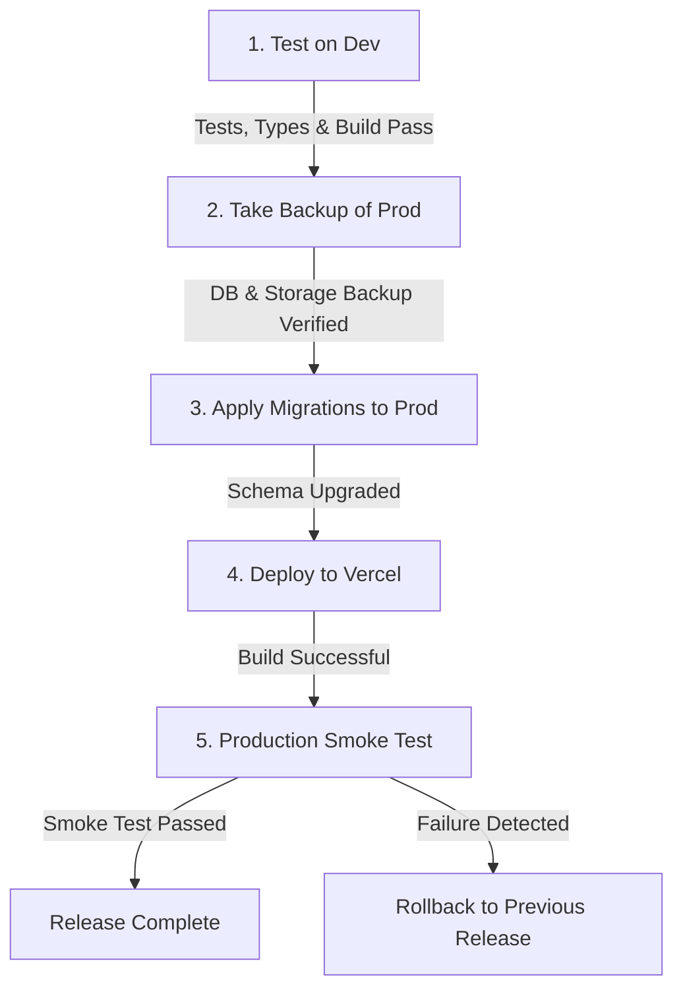

# Westeel Buildings V1 - Release & Operational Runbook

This document defines the strict, repeatable procedures for deploying, backing up, restoring, and releasing updates to the Westeel Buildings Operations & Control Dashboard.

---

## 1. Supabase Platform Verification & SLA Specifications

Based on official Supabase platform documentation (retrieved from [Supabase Database Backups](https://supabase.com/docs/guides/platform/backups) and [Supabase Project Pausing](https://supabase.com/docs/guides/platform/free-project-pausing)):

### A. Database Backups
* **Free Plan:**
  * **No automated daily backups.**
  * Free plan databases must maintain off-site backups using the logical backup tool (`npm run backup`) or Supabase CLI.
* **Pro Plan ($25/month):**
  * **Automated Daily Backups:** 7-day retention period. Downloadable and restorable directly from the Supabase Dashboard (`Database > Backups`).
  * **Point-in-Time Recovery (PITR):** Optional paid add-on powered by WAL-G archiving with a 2-minute Recovery Point Objective (RPO) down to second-level granularity. Requires at least a Small compute add-on.
* **Critical Platform Caveats:**
  * **Storage API Files Excluded:** Database backups snapshot Postgres tables and metadata only. **They do not include binary files stored via the Supabase Storage API** (such as site report photos and drawing PDFs in the `project-files` bucket). Files must be backed up separately via `npm run backup:storage`.
  * **Custom Roles Passwords:** Daily backups omit custom database role passwords for security. If restoring from a platform snapshot, custom database role passwords must be re-applied.

### B. Project Pausing & Inactivity Policy
* **Free Plan Projects:**
  * Automatically paused if there is insufficient database activity over a **7-day window**.
  * Warning email is dispatched ~7 days prior to pause; confirmation email upon pause.
  * Paused projects can be resumed within a **1-year window** via the Supabase Dashboard. After 1 year, the project is permanently removed.
* **Paid / Pro Plan Projects:**
  * **Exempt from pausing.** Paid projects run continuously with zero downtime from inactivity.
* **Production Recommendation:** The production project `westeel-prod` must run on the **Pro Plan** to guarantee continuous uptime during operations and daily automated disaster-recovery snapshots.

---

## 2. Backup & Restore Procedures

### A. Logical Database Backup
Logical backups export all public tables, enums, triggers, and data rows in strict foreign-key dependency order as executable SQL inserts into `backups/`:

```bash
# Generate a timestamped database backup and metadata summary
npm run backup
```

* **Output Location:** `backups/westeel_backup_<YYYY-MM-DDTHH-mm-ss-msZ>.sql`
* **Metadata Record:** `backups/westeel_backup_<timestamp>.json`
* **Tables Dumped (All 30 Tables in Dependency Order):**
  1. `project_stages` (9 fixed PEB workflow stages)
  2. `profiles` (User identity profiles)
  3. `user_roles` (Role assignments per user)
  4. `app_settings` (Application configuration parameters)
  5. `cost_categories` (11 seeded PEB cost categories)
  6. `lead_sources` (8 active sales lead sources)
  7. `lost_reasons` (6 PEB lost opportunity reasons)
  8. `customers` (Master customer directory)
  9. `enquiries` (Sales enquiries and requirements)
  10. `quotations` (Quotation register and revision records)
  11. `enquiry_followups` (Sales logs: calls, meetings, site visits)
  12. `projects` (Active PEB engineering projects)
  13. `project_members` (Team member project allocations)
  14. `project_milestones` (Project milestone deliverables)
  15. `tasks` (Action items and site issues)
  16. `task_comments` (Discussion threads on tasks)
  17. `site_reports` (Daily mobile-first site progress reports)
  18. `payment_milestones` (Billing schedule milestones)
  19. `invoices` (Customer tax invoices)
  20. `receipts` (Customer payment receipts & TDS)
  21. `budget_lines` (Project ex-GST budget lines)
  22. `vendor_orders` (Purchase orders to suppliers/contractors)
  23. `bills` (Vendor bills & expenses)
  24. `bill_payments` (Disbursements to vendors)
  25. `documents` (Drawings, revisions, and site attachments)
  26. `project_commercials` (Contract values ex-GST)
  27. `variation_orders` (Approved variation orders)
  28. `bank_balances` (Dated manual bank balance records)
  29. `company_cash_items` (Overhead, payroll & non-project cash items)
  30. `audit_log` (Append-only governance audit entries)

### B. Storage Files Backup
Because database backups only include file metadata, all binary files (photos, blueprints, contracts) must be backed up from the private `project-files` bucket:

```bash
# Download all private storage objects into local backups
npm run backup:storage
```

* **Output Location:** `backups/storage_files/<timestamp>/`

### C. Restore Verification Test
A repeatable restore test verifies that backups restore without errors or data loss:

```bash
# Execute end-to-end restore verification against an isolated schema
npx supabase db query --linked -f scripts/run_restore_test.sql
```

#### Verified Restore Test Output (Task T9 Benchmark):
```
| Table Name         | Public Rows | Restored Rows | Verification Status |
|--------------------|-------------|---------------|---------------------|
| app_settings       | 0           | 0             | EXACT_MATCH         |
| audit_log          | 28          | 28            | EXACT_MATCH         |
| documents          | 1           | 1             | EXACT_MATCH         |
| profiles           | 6           | 6             | EXACT_MATCH         |
| project_members    | 3           | 3             | EXACT_MATCH         |
| project_milestones | 0           | 0             | EXACT_MATCH         |
| project_stages     | 9           | 9             | EXACT_MATCH         |
| projects           | 2           | 2             | EXACT_MATCH         |
| site_reports       | 3           | 3             | EXACT_MATCH         |
| task_comments      | 0           | 0             | EXACT_MATCH         |
| tasks              | 2           | 2             | EXACT_MATCH         |
| user_roles         | 6           | 6             | EXACT_MATCH         |
```
**Result: 12/12 Tables Confirmed Exact Match (Zero Missing Rows).**

---

## 3. Production Environment Configuration (`westeel-prod`)

### A. Environment Variables Required on Vercel
Configure the following environment variables in the Vercel Project Settings (`Production` and `Preview` scopes):

| Variable Name | Description | Example / Note |
|---|---|---|
| `NEXT_PUBLIC_SUPABASE_URL` | Production Supabase project URL | `https://<prod-ref>.supabase.co` |
| `NEXT_PUBLIC_SUPABASE_ANON_KEY` | Production publishable anon key | `sb_publishable_...` |
| `NEXT_PUBLIC_SUPABASE_PUBLISHABLE_KEY` | Copy of anon key for SSR | `sb_publishable_...` |
| `SUPABASE_SERVICE_ROLE_KEY` | Production server-only service-role key | *Keep secret, never expose to client* |
| `DIRECTOR_MFA_ENFORCED` | Enforces TOTP MFA for Director role | `true` |

### B. Supabase Auth Configuration on Production
1. In the Supabase Dashboard for `westeel-prod`:
   * Navigate to **Authentication > URL Configuration**.
   * **Site URL:** Set to `https://<your-production-domain>.vercel.app` (or custom domain `https://westeel.in`).
   * **Redirect URLs:** Add:
     * `https://<your-production-domain>.vercel.app/**`
     * `https://<your-production-domain>.vercel.app/x9admin`
     * `https://<your-production-domain>.vercel.app/employee`
2. **Director MFA Enforcement:**
   * Director logs in at `https://<your-production-domain>.vercel.app/x9admin`.
   * The Director profile prompts for TOTP authenticator enrollment (Google Authenticator, Microsoft Authenticator) upon initial login.

### C. Dev Seed Isolation Check
* Ensure dev test accounts (`sales@westeel.test`, `inactive@westeel.test`, dummy test tasks) are **never applied** to production.
* Run only the clean migrations (`001` through `005`) without test seed scripts.

---

## 4. Standard Operating Procedure (SOP) for Future Releases

Every future deployment must execute this 5-step sequence in order:



### Step 1: Test on Dev
Run all quality gates locally against `westeel-dev`:
```bash
npm test                  # Must pass 100% of unit tests
npm run typecheck         # Zero TypeScript errors
npm run lint              # Zero ESLint warnings or errors
npm run build             # Production compilation check
```

### Step 2: Take a Backup of Prod
Before applying any change to production, snapshot both the database and file storage:
```bash
# 1. Take database snapshot
npm run backup

# 2. Backup storage files
npm run backup:storage
```

### Step 3: Apply Migrations to Prod
Apply new migration files in numbered order:
```bash
# Example for future migration 006
npx supabase db query --linked -f supabase/migrations/006_new_feature.sql
```

### Step 4: Deploy to Vercel
Deploy the committed code to production:
```bash
# Push to main branch for automated Vercel CI/CD, or deploy directly via Vercel CLI:
git push origin main
# Or: npx vercel --prod
```

### Step 5: Production Smoke Test Checklist
Immediately following deployment, perform the smoke test checklist:
- [ ] **System Health:** Visit `/api/health` and verify `{"status":"ok","database":"connected"}`.
- [ ] **Root Landing Page:** Visit `/` and verify minimal branding with zero exposed admin cards.
- [ ] **Director Portal (`/x9admin`):**
  - Authenticate with Director credentials.
  - Verify MFA prompt.
  - Verify Block 1 overview metrics load without errors.
  - Verify Alerts list renders live computed items with zero fake data.
- [ ] **Employee Portal (`/employee`):**
  - Enter passcode `site` and confirm Site Engineer workspace displays.
  - Test submitting a dummy report or check existing report status.
  - Enter passcode `pm` and confirm Review queue displays.
- [ ] **Audit Trail:** Verify that the test actions generated corresponding entries in `audit_log`.

### Rollback Procedure
If any critical defect is identified during the smoke test:
1. Revert the Vercel deployment instantly to the prior release from the Vercel Dashboard (**Deployments > Promote to Production**).
2. If database schema changes caused breakage, restore the database snapshot taken in Step 2:
   ```bash
   npx supabase db query --linked -f backups/westeel_backup_<timestamp>.sql
   ```
3. Post an incident summary to `DECISIONS.md`.

---

## 5. Gate G1: Real Usage Trial Protocol

Per `PROJECT_BRIEF.md`, completion of Priority 1 requires the **GATE G1** trial:

* **Duration:** At least 1 week of active real-world usage on a live project.
* **Participants:**
  * The Director
  * At least 1 Site Engineer
  * At least 1 Project Manager
* **Activities to Exercise:**
  * Active project creation and milestone tracking.
  * Task creation, assignment, and status updates (including flagging a blocked issue).
  * Daily site report submission with compressed field photos from mobile devices.
  * Project Manager review and approval/correction flow (Rule R6).
  * Drawing uploads, version revisions, and Director/PM approval (Rules R5 and R7).
  * Live monitoring via Director Overview Block 1 and Alerts feed (Rule R11).
* **Sign-off:** Send `GATE G1 PASSED` only after real usage is verified and any non-critical defects are documented for Task T15.
